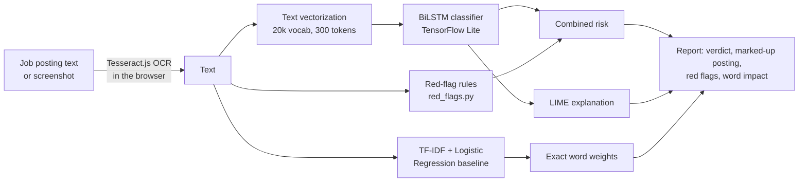

# ScamShield: Explainable Hiring Scam Detector

Paste a job posting, or upload a screenshot of one, and ScamShield tells you how likely it is to be a scam **and why**: which words the AI weighed, which red flags it found, and how a second, simpler model sees the same text.

**Live demo:** https://hiring-scam-detector.onrender.com

Final-year mini project, Dept. of CSE, P.A. College of Engineering (2026-27).


## What it does

- **Verdict with an overall risk level.** A BiLSTM deep-learning model scores the posting, and red-flag rules can raise the risk: Low, Medium ("Be careful") or High ("Likely a scam").
- **The posting, marked up.** Words that pushed the AI towards *scam* or *genuine* are highlighted, and phrases that match a red flag are underlined.
- **Red flags in plain English.** Eight checks, e.g. *asks you to pay money*, *asks for ID or bank details*, *contact only through WhatsApp*, *personal Gmail address*. Each one shows the exact phrase that triggered it.
- **Compare explanations.** LIME on the deep model next to the exact word weights of a Logistic Regression baseline, plus the words both models agree on.
- **Read from a screenshot.** OCR runs in the visitor's browser (Tesseract.js), so the image never leaves their device.
- **Save as PDF / share** a summary of the result. The posting text is never put into a link.


<table>
<tr>
<td width="60%"></td>
<td width="40%"></td>
</tr>
</table>

## How it works



1. **Training data:** real and fake job postings from the EMSCAD dataset (Kaggle).
2. **Text to numbers:** each posting is lower-cased, stripped of punctuation and turned into up to 300 word IDs from a 20,000-word vocabulary.
3. **BiLSTM classifier:** reads the words in both directions and outputs the probability that the posting is fraudulent (scam threshold 0.61).
4. **Explanation:** LIME scores 500 copies of the posting with random words removed and fits a local model to see which words move the score. It explains the model's log-odds, which keeps the weights readable even when the model is 99.9% sure. Filler words are dropped.
5. **Combined risk:** each red flag adds to the model's log-odds (+1.5 for asking for money or ID/bank details, +0.75 for the others, at most +4). A serious flag also lifts the result to at least 40% ("Be careful"). Rules can only raise the risk, never lower it.


## Tech stack

| Part | Technology |
|---|---|
| Model | TensorFlow / Keras BiLSTM, served with LiteRT (TensorFlow Lite) |
| Baseline | scikit-learn TF-IDF + Logistic Regression |
| Explainability | LIME, rule-based red flags |
| Backend | Flask + Gunicorn |
| Frontend | HTML, CSS, vanilla JavaScript, Tesseract.js (OCR) |
| Hosting | Render (free tier), GitHub Actions keep-alive |

The server doesn't import TensorFlow at all: TensorFlow alone needs about 600 MB of RAM, more than Render's free 512 MB. The LSTM runs from a TensorFlow Lite file and the text vectorizer is re-implemented in Python from the exported vocabulary. Memory use is about 214 MB, with identical predictions.

## Project structure

```
app.py                  Flask app: /predict (verdict + red flags), /explain (LIME + baseline), /version
red_flags.py            Rule-based scam checks with plain-English reasons (add new rules here)
convert_tflite.py       Converts model/scam_model.keras to scam_core.tflite + vocab.json
gunicorn.conf.py        1 worker, 120 s timeout (picked up automatically by gunicorn)
model/
  scam_model.keras      Trained BiLSTM (source for convert_tflite.py)
  scam_core.tflite      BiLSTM used by the server
  vocab.json            Vectorizer vocabulary used by the server
  tfidf.pkl, logreg.pkl Baseline model
  config.json           Best model + decision threshold
templates/index.html    Page
static/                 style.css, script.js (results), ocr.js (screenshot reading)
.github/workflows/      keep-alive.yml (pings the site every 5 min so Render doesn't sleep)
```

## Run locally

```bash
python -m venv venv && source venv/bin/activate   # Windows: venv\Scripts\activate
pip install -r requirements.txt
python app.py                                     # http://127.0.0.1:5000
```

## After retraining the model

Save the new model as `model/scam_model.keras`, then regenerate the files the server uses before pushing:

```bash
pip install -r requirements-dev.txt   # includes TensorFlow
python convert_tflite.py              # writes scam_core.tflite + vocab.json and checks they match
```

## Deployment

Render runs `gunicorn app:app`, which reads `gunicorn.conf.py`. Every push to `main` redeploys. The version shown in the page footer (and at `/version`) is bumped on each release, so you can tell when a deploy is live.

## Known limitations

- The BiLSTM learned from EMSCAD, which has few Indian-style scams. It treats "fee" and "registration" as slightly reassuring, and can over-react to words like "urgent". The red-flag rules and the baseline comparison make this visible, and retraining with more examples is planned.
- English only. OCR often misreads the ₹ sign, so check the extracted text before analysing.
- Free hosting: the first request after a redeploy can take a minute.

## Team

- Muhammad Abdul Jaleel (4PA24CS064)
- Muhammed Adhil P (4PA24CS066)
- Muhammed Nafih CP (4PA24CS068)
- Nazal Noushad (4PA24CS086)

**Guide:** Prof. Zuhara, Dept. of CSE, P.A. College of Engineering
