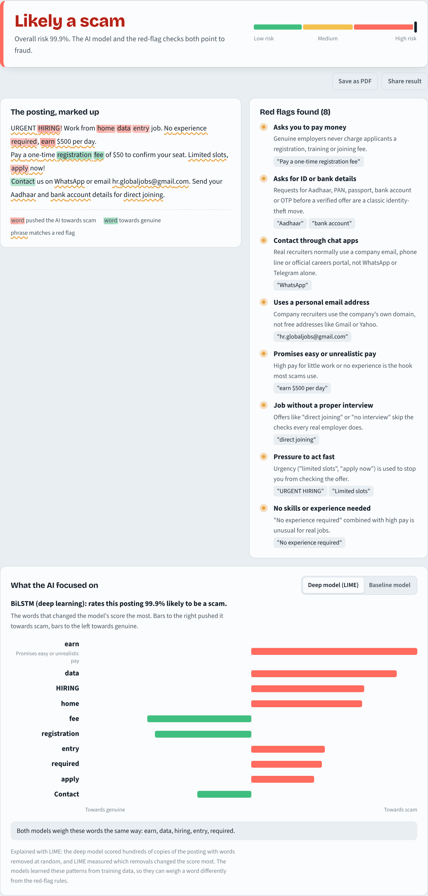
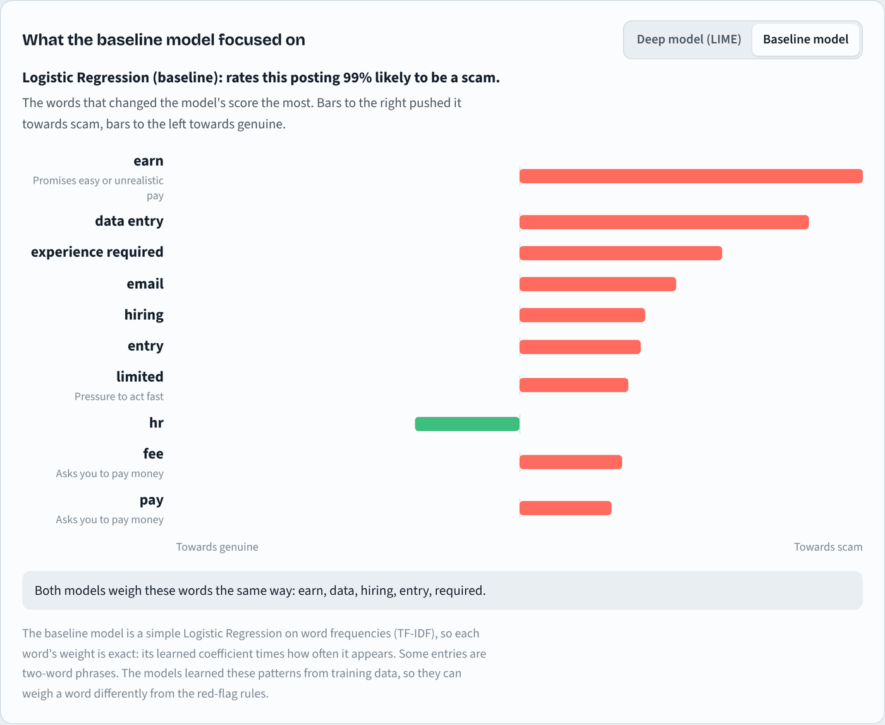
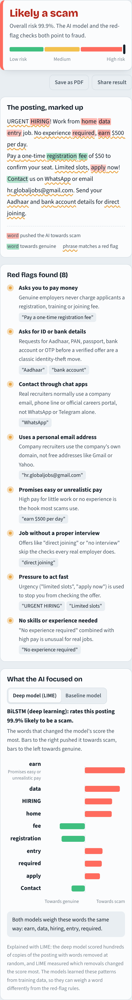
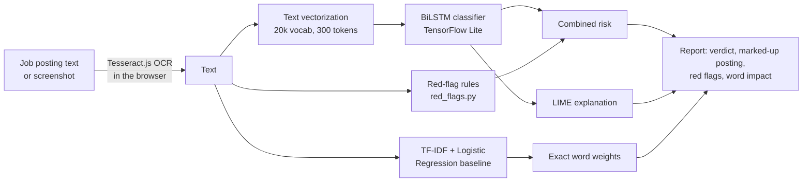
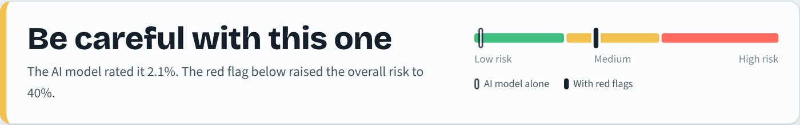

# ScamShield: Explainable Hiring Scam Detector

Paste a job posting, or upload a screenshot of one, and ScamShield tells you how likely it is to be a scam **and why**: which words the AI weighed, which red flags it found, and how a second, simpler model sees the same text.

**Live demo:** https://hiring-scam-detector.onrender.com

Final-year mini project, Dept. of CSE, P.A. College of Engineering (2026-27).


## What it does

- **Verdict with an overall risk level.** A BiLSTM deep-learning model scores the posting, and red-flag rules can raise the risk: Low, Medium ("Be careful") or High ("Likely a scam").
- **The posting, marked up.** Words that pushed the AI towards *scam* or *genuine* are highlighted, and phrases that match a red flag are underlined.
- **Red flags in plain English.** Eight checks, e.g. *asks you to pay money*, *asks for ID or bank details*, *contact only through WhatsApp*, *personal Gmail address*. Each one shows the exact phrase that triggered it.
- **Compare explanations.** LIME on the deep model next to the exact word weights of a Logistic Regression baseline, plus the words both models agree on.
- **Read from a screenshot.** OCR runs in the visitor's browser (Tesseract.js), so the image never leaves their device.
- **Save as PDF / share** a summary of the result. The posting text is never put into a link.



<table>
<tr>
<td width="60%"></td>
<td width="40%"></td>
</tr>
</table>

## How it works



1. **Training data:** the EMSCAD dataset (Kaggle, 17,880 postings, 866 fake) plus 1,200 synthetic Indian postings (half scams, half genuine). See [Model performance](#model-performance).
2. **Text to numbers:** each posting is lower-cased, stripped of punctuation and turned into up to 300 word IDs from a 20,000-word vocabulary.
3. **BiLSTM classifier:** reads the words in both directions and outputs the probability that the posting is fraudulent.
4. **Explanation:** LIME scores 500 copies of the posting with random words removed and fits a local model to see which words move the score. It explains the model's log-odds, which keeps the weights readable even when the model is 99.9% sure. Filler words are dropped.
5. **Combined risk:** each red flag adds to the model's log-odds (+1.5 for asking for money or ID/bank details, +0.5 for the others, at most +4). A serious flag also lifts the result to at least 40% ("Be careful"). Rules can only raise the risk, never lower it, and they ignore reassurances like "we never ask for bank details". A posting is flagged as a scam at **50%** or more (chosen on the validation set).



## Model performance

All numbers are on postings never used in training, for the full check the site shows (AI model + red-flag rules). Produced by `training/train.py`; full results in `model/metrics.json`.

| Test set | Original model | Retrained model (live) |
|---|---|---|
| Real postings, EMSCAD 20% test split (3,576, 173 fake) | F1 0.913* | F1 0.817: 125 of 173 scams caught, 8 false alarms |
| Indian-style posts, generated from held-out phrases (300) | F1 0.320 | F1 0.997 |
| Hand-written Indian posts (28) | F1 0.571 | F1 0.880 |

\* The original model was trained on data that overlaps this test split: it scores about 0.90 on every part of EMSCAD, including rows it trained on. Retraining the same architecture and settings on the clean split gives F1 0.823, a fair estimate of the original approach. The retrained model matches it on real postings and catches far more Indian-style scams.

**Why the original model missed Indian scams:** EMSCAD has only 14 fake postings from India. "Registration" appears in 46 postings and 98% of them are genuine, and "WhatsApp" appears in 31 postings, all genuine. "Aadhaar" and "Telegram" never appear. So the model learned those words as safe. The retrained model adds synthetic examples (`training/augment_india.py`) built from separate phrase pools for training and testing, plus a hand-written test set (`training/india_handwritten_test.json`). These examples are synthetic, not real collected scams.

## Tech stack

| Part | Technology |
|---|---|
| Model | TensorFlow / Keras BiLSTM, served with LiteRT (TensorFlow Lite) |
| Baseline | scikit-learn TF-IDF + Logistic Regression |
| Explainability | LIME, rule-based red flags |
| Backend | Flask + Gunicorn |
| Frontend | HTML, CSS, vanilla JavaScript, Tesseract.js (OCR) |
| Hosting | Render (free tier), GitHub Actions keep-alive |

The server doesn't import TensorFlow at all: TensorFlow alone needs about 600 MB of RAM, more than Render's free 512 MB. The LSTM runs from a TensorFlow Lite file and the text vectorizer is re-implemented in Python from the exported vocabulary. Memory use is about 214 MB, with identical predictions.

## Project structure

```
app.py                  Flask app: /predict (verdict + red flags), /explain (LIME + baseline), /version
red_flags.py            Rule-based scam checks with plain-English reasons (add new rules here)
convert_tflite.py       Converts model/scam_model.keras to scam_core.tflite + vocab.json
training/
  train.py              Trains + evaluates the BiLSTM and baseline (writes model/metrics.json)
  augment_india.py      Synthetic Indian scam / genuine postings (separate train and test phrases)
  india_handwritten_test.json  Hand-written Indian test posts (never used for training)
gunicorn.conf.py        1 worker, 120 s timeout (picked up automatically by gunicorn)
model/
  scam_model.keras      Trained BiLSTM (source for convert_tflite.py)
  scam_core.tflite      BiLSTM used by the server
  vocab.json            Vectorizer vocabulary used by the server
  tfidf.pkl, logreg.pkl Baseline model
  config.json           Best model + decision threshold
  metrics.json          Test results shown in the "How accurate is it?" section
templates/index.html    Page
static/                 style.css, script.js (results), ocr.js (screenshot reading)
.github/workflows/      keep-alive.yml (pings the site every 5 min so Render doesn't sleep)
```

## Run locally

```bash
python -m venv venv && source venv/bin/activate   # Windows: venv\Scripts\activate
pip install -r requirements.txt
python app.py                                     # http://127.0.0.1:5000
```

## Retraining

Download `fake_job_postings.csv` (EMSCAD) from Kaggle, then:

```bash
pip install -r requirements-dev.txt                                   # includes TensorFlow
python training/train.py --data fake_job_postings.csv --out model     # about 3 minutes on a laptop CPU
python convert_tflite.py                                              # writes scam_core.tflite + vocab.json, checks they match
```

`train.py` uses the original architecture and settings, a fixed 80/20 split, early stopping on validation, and picks the cut-off on validation. It prints and saves results for three test sets (`model/metrics.json`). Use `--no-augment` to train on EMSCAD only, or `--evaluate <folder>` to score an existing model. The scikit-learn version in `requirements.txt` must match the one used for training, because the baseline is saved with pickle.

## Deployment

Render runs `gunicorn app:app`, which reads `gunicorn.conf.py`. Every push to `main` redeploys. The version shown in the page footer (and at `/version`) is bumped on each release, so you can tell when a deploy is live.

## Known limitations

- The Indian training and test examples are synthetic or hand-written, not real collected scams; real-world accuracy on Indian posts will be lower than the test numbers. Collecting real reported scams is the next step.
- On real EMSCAD postings the model catches about 72% of scams with very few false alarms (8 of 3,403 genuine). It errs on the side of not accusing genuine employers.
- English only. OCR often misreads the ₹ sign, so check the extracted text before analysing.
- Free hosting: the first request after a redeploy can take a minute.

## Team

- Muhammad Abdul Jaleel (4PA24CS064)
- Muhammed Adhil P (4PA24CS066)
- Muhammed Nafih CP (4PA24CS068)
- Nazal Noushad (4PA24CS086)

**Guide:** Prof. Zuhara, Dept. of CSE, P.A. College of Engineering
